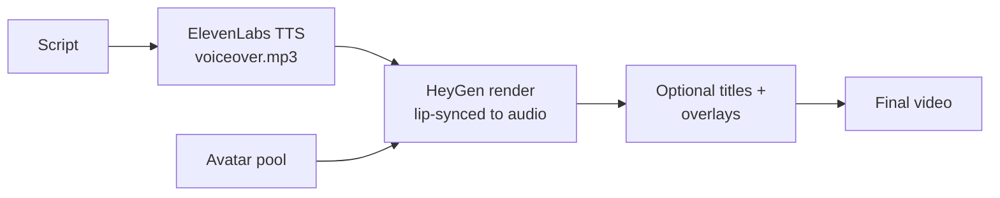

# avatar-video-pipeline

A shareable **Claude Agent Skill** that turns a script (or a topic) into a
finished talking-avatar video.

> **🔑 No secrets — configure your own.**
> This repo contains **no API keys and no account-specific IDs**. Nothing is
> hardcoded to any one voice or avatar. You supply your own ElevenLabs API key
> (via an environment variable) and your own voice/avatar settings (via a local
> `config.json` you create from the template). Do **not** commit your key or
> your `config.json`.

## Demo

The helper scripts: reproducible avatar selection, and a TTS step that refuses to run without your own key in the environment.


## What it does



1. **Script** — write / refine the narration.
2. **Voiceover** — ElevenLabs text-to-speech → `voiceover.mp3`.
3. **Avatar pick** — randomize a HeyGen `avatar_id` from a pool (dynamic discovery or a configured list).
4. **Render** — a HeyGen avatar driven by the ElevenLabs audio, so the lips sync to the real voice.
5. **Marry** — the render *is* the marriage (audio-in == final voice); an ffmpeg mux is documented as a fallback.
6. **Titles / HyperFrames** — optional title cards, lower-thirds, and overlays.

It's account-agnostic, so it can be shared publicly and run against anyone's
HeyGen + ElevenLabs accounts.

## Install

**As a personal skill**

```bash
npx skills add brie-wieselman/avatar-video-pipeline
```

...or clone this repo into your skills directory:

```bash
git clone https://github.com/brie-wieselman/avatar-video-pipeline \
  ~/.claude/skills/avatar-video-pipeline
```

**As a project skill** — copy this repo's contents into your project's
`.claude/skills/avatar-video-pipeline/` directory.

Either way, Claude discovers the skill automatically and invokes it when you ask
to make an avatar / spokesperson / ElevenLabs + HeyGen video.

## Requirements

- **HeyGen** MCP server connected (avatar render + asset upload tools).
- **ElevenLabs** API key in the `ELEVENLABS_API_KEY` environment variable.
- **(optional)** HyperFrames (MCP or the `heygen-com/hyperframes` local skills)
  for titles/overlays.
- Python 3 (the helper scripts use the standard library only — no `pip install`).

## Configure

```bash
cp references/config.example.json config.json   # then edit config.json
export ELEVENLABS_API_KEY="your-key-here"        # never commit this
```

Set your ElevenLabs `voice_id` in `config.json` (plus, optionally, an avatar
pool, dimensions, and background). Everything else has sane defaults. See
`SKILL.md` for the full key reference. `config.json` is git-ignored by default.

## Files

| File | Purpose |
| --- | --- |
| `SKILL.md` | The skill Claude reads — the 6-step pipeline and how to run it. |
| `scripts/elevenlabs_tts.py` | ElevenLabs REST → MP3 (stdlib only). |
| `scripts/pick_avatar.py` | Randomly select an avatar id (configured pool or dynamic discovery). |
| `references/pipeline.md` | Detailed runbook: tool-call shapes, titles/overlays, batching. |
| `references/config.example.json` | Ready-to-copy config template (placeholders only). |

## Security

Never commit API keys. `ELEVENLABS_API_KEY` is read from the environment at
runtime; the config file holds only non-secret ids and settings, and your
working `config.json` is git-ignored.

## License

MIT — see [LICENSE](LICENSE).
